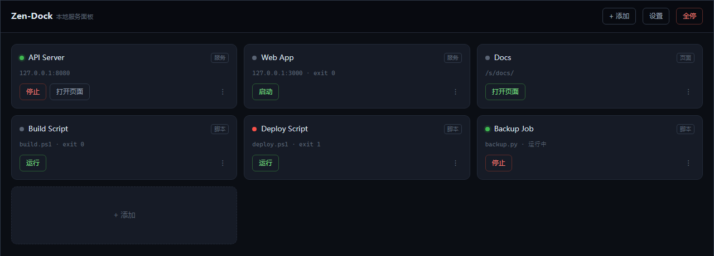
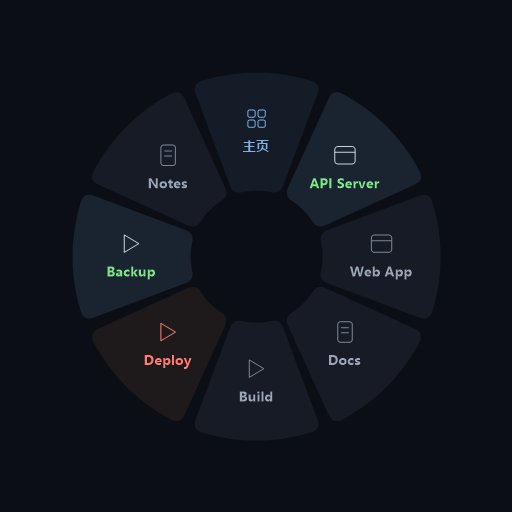
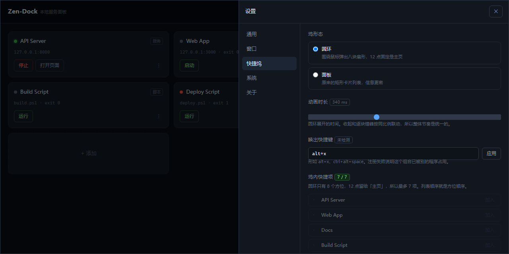
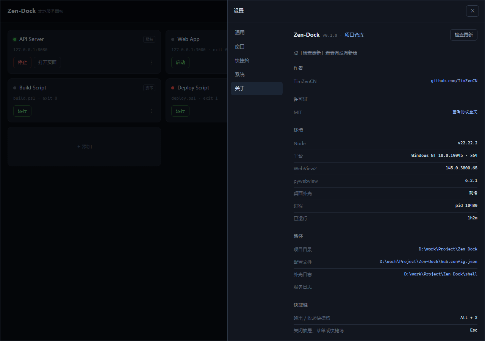

# Zen-Dock

**A local service panel.** Supervise long-running services, fire one-shot scripts, and serve static pages — all from one window.

`Node 20+` · `Zero dependencies` · `No build step` · `MIT` · `Windows`

English | [简体中文](README.md)



## Requirements

- **Core:** Node 20+, zero dependencies
- **Desktop window:** Python 3.10+ and the system WebView2 runtime
- Windows is the primary target. The core runs on Linux/macOS; the desktop shell degrades there.

## Features

- **Zero dependencies, no build step.** No `npm install`, no bundler. `node index.mjs` and you're up.
- **Three kinds of things, one panel.** Long-running services (with ports and health checks), one-shot scripts (PS1 / PY / BAT), and static pages.
- **A real desktop window.** Not a browser wrapper: frameless, self-drawn title bar, tray, global hotkey, launch on login.
- **Ring dock.** Hit `Alt+X` and eight sectors bloom around your cursor — one click to start. True per-pixel alpha, not fake transparency.
- **CLI.** `zd` covers everything, with `--json` output for scripts and AI agents.
- **Live config reload.** Edit `hub.config.json` and it picks up immediately. The page and the CLI touch the same file.

## Getting started

### In the browser

```bash
node index.mjs                 # start and open a browser
node index.mjs --no-open       # don't open
node index.mjs --port 7718     # change the port (hub port is --hub-port)
```

Defaults to `http://127.0.0.1:7717`. On Windows you can also double-click `zen-dock.ps1` (`-Restart` kills whatever holds the port first).

### Desktop window

Double-click `zen-dock-window.bat`. **First run:** execute `shell/setup.bat` once — it creates `.venv` and installs pywebview / pystray / pillow / numpy (needs Python 3.10+).

The window is frameless; the title bar and the three window buttons are drawn by the page:

- Drag the title bar to move, double-click to maximize, 5px edge zones to resize
- What closing does is a setting: quit, or minimize to tray
- `--hidden` starts straight into the tray (**this is what launch-on-login registers**, so nothing pops up at boot)

**The shell is optional.** `index.mjs` stays a zero-dependency Node server — skip pywebview and use the browser. If something is already listening on the port, the window attaches to it, and closing the window **won't** kill that server.

### CLI

```powershell
.\install-cli.ps1          # adds to user PATH, leaves system PATH alone, no admin needed
```

Open a **new terminal** afterwards and `zd` works. `-Status` to check, `-Uninstall` to revert. The old PATH is backed up to `shell/path-backup-<timestamp>.txt`.

## Screens

### Ring dock

Press `Alt+X` and it appears at the cursor. Eight sectors: Home is pinned at 12 o'clock, the rest follow the order set in Settings. Each carries an icon, a name, and a status color — green running, red failed, gray stopped.



Click empty space or press the hotkey again to dismiss, with a collapse animation. Duration is configurable (100–800ms).

### Settings

Five groups on the left: General / Window / Dock / System / About.



### About

Version, author, license, environment, paths, shortcuts.



Metadata comes from `package.json` (`author` / `repository` / `license`) — nothing hard-coded. The update check hits GitHub's `releases/latest` from the server and caches for 10 minutes (unauthenticated API allows 60 requests/hour).

## The three item kinds

| kind | What it is | Key fields |
|---|---|---|
| `service` | Long-running process with a port and health check | `cmd` `args` `cwd` `port` `url` `urlFrom` |
| `script` | One-shot script | `shell` `path` `params` |
| `page` | Static page or directory, served at `/s/<id>/` | `dir` `entry` |

```json
{
  "id": "api",
  "kind": "service",
  "name": "API Server",
  "cmd": "node",
  "args": ["server.js"],
  "cwd": "./services/api",
  "port": 8080,
  "url": "http://127.0.0.1:8080/"
}
```

### When the service announces its own address

Some services print their real URL after starting, and it changes every time (typically a one-time token). Set `urlFrom` and the hub matches it in the output, taking the first capture group as the URL:

```json
{
  "id": "dsh-web",
  "kind": "service",
  "cmd": "node",
  "args": ["D:/tools/node_modules/@deepseek-ai/dsh/lib/bin.js", "web", "--no-open"],
  "port": 3080,
  "urlFrom": "dsh web: (http\\S+)",
  "startTimeoutMs": 30000
}
```

The captured address goes into `runtime.url`; "Open" and `zd open` prefer it. Startup waits for the address to appear (10s default, `urlWaitMs`) so you don't click the moment it turns green and hit a 401.

### Script parameters

`shell` accepts `powershell` / `python` / `bat`. `params` render as inputs in the detail view:

```json
{
  "kind": "script",
  "shell": "powershell",
  "path": "./scripts/deploy.ps1",
  "params": [
    { "name": "port", "flag": "--port", "type": "number", "default": 8080 },
    { "name": "verbose", "flag": "--verbose", "type": "boolean", "default": false }
  ]
}
```

## Configuration

Everything lives in `hub.config.json`. Edit it by hand (hot reload) or use "+ Add" in the page.

On first run it's copied from `hub.config.example.json`. **`hub.config.json` is gitignored** — it holds absolute paths and is personal. Paths starting with `./` in the template resolve against the project root, so the example works on any machine.

Dock-related settings:

```json
"dockMode": "ring",
"dockItems": ["api", "web", "build", "deploy", "backup", "notes"]
```

`dockItems: null` means "never configured" and auto-fills the first 7 enabled items; an explicit `[]` means "none". Add `shortName` to an item to control the label inside the ring.

## CLI

```
zd                        list everything
zd status                 hub itself: address, item count, what's running
zd start <id>             start, returns after the port responds
zd stop <id>              stop, kills the whole process tree
zd restart <id>
zd run <id> [--flag val]  run a script, flags mapped from params
zd logs <id> [-f] [-n 50] tail logs, -f follows
zd open <id>              open with the configured browser
zd add / zd edit / zd rm  create, edit, delete
zd settings [key=value]   read or write settings
zd stop-all               stop everything
zd up                     run the hub in the foreground
zd help [command]
```

`zd add` with no arguments walks an interactive wizard; with arguments it writes directly:

```bash
zd add service api --name "API Server" --cmd node --args "server.js" --port 8080
zd add script deploy --shell powershell --path "run.ps1"
zd add page notes --dir "./sites/notes"
```

**When the hub isn't running**, `list` `show` `add` `edit` `rm` `settings` still work (they read and write the config file); `start` `stop` `run` `logs` `open` fail — process state only exists in the hub's memory, and a CLI that spawns on its own would fight the panel.

Every command supports `--json`:

```bash
zd --json list | jq '.items[] | select(.runtime.status == "running") | .id'
```

Exit codes: `0` ok, `1` error, `2` hub not running. `--no-color` or `NO_COLOR` disables color; redirected output disables it automatically.

## Design notes

**Zero dependencies.** No bundler, no framework, no `node_modules`. The cost is UI written as template strings in a single `lib/panel.js`; the payoff is that a clone runs immediately and won't rot in six months.

**State is decided by the port.** `starting → running` is gated on a **TCP connect**, not "the process started". A green card means "the port actually accepts connections". Services without `port` fall back to liveness checks.

**Stopping means killing.** On Windows, Node's `SIGTERM` is `TerminateProcess`, and `taskkill` without `/F` sends `WM_CLOSE`, which only reaches GUI windows. So stop is always `taskkill /PID x /T /F` — the whole tree, otherwise `npm run dev`'s grandchildren keep the port. Services that need cleanup should handle signals themselves.

**Start deduplication.** Port checks can't see duplicate instances without a port, or ones still booting. So before spawning, the hub scans full command lines (PowerShell + CIM) and **adopts** a matching process instead of spawning another. Matching uses a fingerprint: executable name plus every argument token, order-independent, slashes normalized. Disable per item with `"dedupe": false`.

**Adoption.** Restart the hub and running services survive: a pid recorded in `hub.state.json` that's still alive gets adopted; otherwise the port is looked up via `netstat -ano` and the process is marked `external: true`.

**Encoding.** Child output is split on `\n` at the byte level and then decoded, falling back from strict UTF-8 to GBK — so GBK `.bat` files and Chinese output from PowerShell 5.1 both come through intact. Python gets `PYTHONUTF8=1` and `-u` for real-time output.

**No auto-restart on crash.** It's a personal tool. If it crashes, read the log and fix the bug; auto-restart only hides it.

## Security

Binds to `127.0.0.1` only, and validates `Origin` plus `Sec-Fetch-Site`.

That check isn't paranoia: any page you have open can `fetch('http://127.0.0.1:7717/api/items/x/run')`. Without validation, every website has a script-execution backdoor into your machine.

External links go through `/api/open-external`; the frontend can only pass `kind` (`author` / `repo` / `releases` / `license`) and the real URL is assembled server-side from `package.json`. That endpoint cannot open an arbitrary URL.

No token, because it's local-only. For LAN access you'd add your own.

## Known limitations

- **Absolute paths in static pages 404.** The site root is `/s/<id>/`, not the domain root, so `/css/a.css` won't resolve. Injecting `<base>` only fixes relative paths.
- **Logs are in memory only.** 500 lines per item by default, gone on restart.
- **No reverse proxy.** Each service keeps its own port; the hub only discovers, starts, stops, and links.
- **The desktop shell is Windows-only in practice.** `taskkill`, `CREATE_NO_WINDOW`, `MessageBoxW` are Windows branches, and it needs the system WebView2 runtime.
- **Long names don't fit in the ring.** Two limits: character count (CJK = 2 units, others = 1, cap 10 units = 5 CJK chars), then pixel width (~85px at 13px bold). Overflow gets an ellipsis; use `shortName` to control it.
- **The ring gets clipped near screen edges.** The window centers on the cursor without clamping — clamping would offset the ring from the cursor. Deliberate trade-off.
- **Hotkeys are globally exclusive.** Once registered, no other app receives that combo. Change it in Settings if it collides.
- **The tray icon may be collapsed by Windows.** New icons go into the `^` overflow by default; drag it out to pin it.
- **Ctrl+C for `zd` is only reliable in a real terminal.** Windows has no POSIX signals; `kill -INT` from Git Bash may not arrive. Press it again — the second one force-quits.
- **`--port` is the item's port; the hub port is `--hub-port`.**
- **Scripts that launch via `Start-Process` show as "done", not "running".** The script exits immediately and the real process lives outside the hub — no logs, no stopping it. That's the script's own design.

## Layout

```
index.mjs                    entry point
zen-dock.ps1                 browser launcher (PowerShell)
zen-dock-window.bat          desktop window launcher
zd.cmd / zd                  CLI wrapper
install-cli.ps1              adds project to user PATH (idempotent + backup)
hub.config.example.json      config template (tracked)
hub.config.json              your config (gitignored, auto-created)
bin/zd.mjs                   CLI entry: parsing, dispatch, help
lib/
  server.js                  routing + Origin check + SSE
  config.js                  config validation (atomic writes) + path resolution
  services.js                spawn / health check / kill / adopt / dedupe
  scripts.js                 three shells + argument building
  logs.js                    ring buffer + GBK fallback decoding
  sites.js                   static hosting + <base> injection
  system.js                  browser / explorer / autostart / about info
  panel.js                   admin page + panel dock (inline CSS/JS)
  cli/                       client / format / commands
shell/
  desktop.py                 desktop shell (pywebview + WebView2 + pystray)
  ring.py                    ring dock: layered window + GDI+ painting
  hotkey.py                  global hotkey (RegisterHotKey)
  setup.bat                  creates .venv on first run
sites/<id>/                  static pages
test-scripts/                tests and diagnostics
docs/images/                 README screenshots
```

## Development

```bash
node test-scripts/smoke.mjs          # three shells, smoke (start hub first)
node test-scripts/dedupe.mjs         # command-line fingerprint matching, 9 cases
node test-scripts/dedupe-e2e.mjs     # real processes, adoption, 7 cases

.venv/Scripts/python.exe test-scripts/probe_ring_draw.py         # bitmap alpha
.venv/Scripts/python.exe test-scripts/probe_ring_window.py       # Win32 plumbing
.venv/Scripts/python.exe test-scripts/probe_ring_transparent.py  # screen composition

.venv/Scripts/python.exe test-scripts/snap_panel.py              # UI screenshots
.venv/Scripts/python.exe test-scripts/shot_readme.py             # README images
```

Use `snap_panel.py` to check UI changes without opening and closing the window repeatedly.

## License

[MIT](LICENSE) © 2026 TimZenCN
