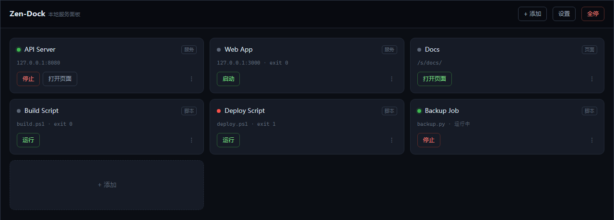
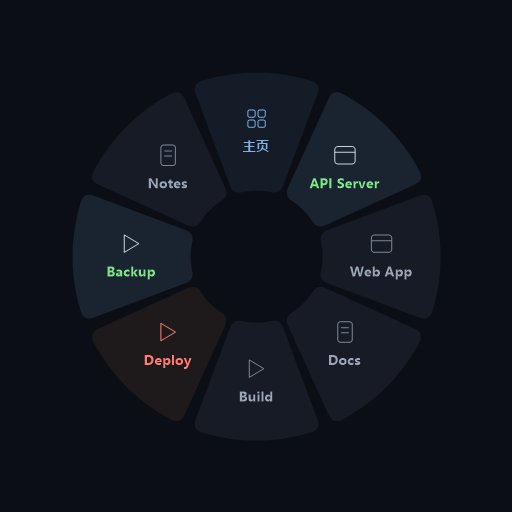
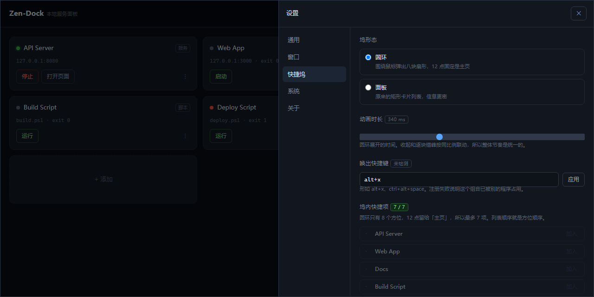
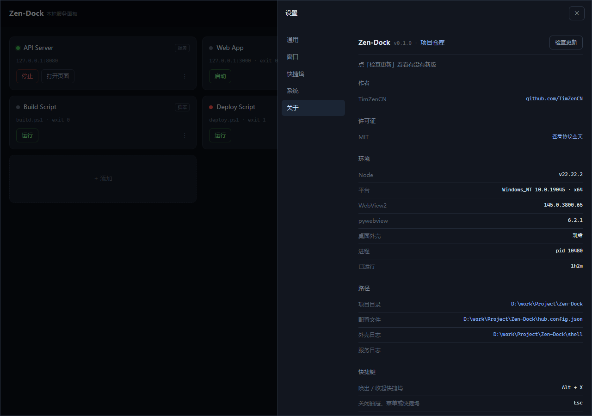

# Zen-Dock

**本地服务面板。** 把常驻服务管起来、把一次性脚本点着跑、把静态页面挂上去——全在一个窗口里。

`Node 20+` · `零依赖` · `无构建步骤` · `MIT` · `Windows`

[English](README.en.md) | 简体中文 |



## 环境要求

- **核心**：Node 20+，零依赖
- **桌面窗口**：Python 3.10+ + 系统 WebView2 运行时
- Windows 是主要目标平台。Linux/macOS 上核心能跑，桌面外壳的 Windows 分支会退化

## 特性

- **零依赖、无构建。** 不需要 `npm install`，没有打包器，源码直交付。`node index.mjs` 就能跑。
- **三种东西一种管法。** 常驻服务（有端口、能探活）、一次性脚本（PS1 / PY / BAT）、静态页面，同一个界面。
- **真正的桌面窗口。** 不是浏览器套壳：无边框、自绘标题栏、托盘常驻、全局热键、开机自启。
- **圆环坞。** 按 `Alt+X` 在鼠标周围弹出八块扇形，点一下就启动。真 per-pixel alpha，不是伪透明。
- **命令行。** `zd` 管理全部功能，支持 `--json`，适合脚本和 AI 调用。
- **改配置不用重启。** `hub.config.json` 热重载，页面和 CLI 改的是同一份。

## 快速开始

### 浏览器

```bash
node index.mjs                 # 起服务，自动开浏览器
node index.mjs --no-open       # 不自动开
node index.mjs --port 7718     # 换端口（hub 端口用 --hub-port）
```

默认 `http://127.0.0.1:7717`。Windows 下也可以双击 `zen-dock.ps1`（支持 `-Restart` 先杀掉占用端口的旧实例）。

### 桌面窗口

双击 `zen-dock-window.bat`。**首次使用**先跑 `shell/setup.bat`，它会建 `.venv` 并装 pywebview / pystray / pillow / numpy（需要 Python 3.10+）。

窗口是无边框的，标题栏和三个窗口按钮都由页面自己画：

- 拖标题栏移动、双击最大化/还原、四边四角 5px 内缩放
- 关闭时做什么在**设置 → 窗口**里选：退出程序 / 最小化到托盘
- 加 `--hidden` 静默启动，直接进托盘（**开机自启注册的就是这个模式**，开机不会弹窗）

**外壳和核心是分开的。** `index.mjs` 依然是零依赖的纯 Node 服务，不装 pywebview 也能用浏览器访问，`shell/` 只是多一层可选外壳。端口上已经有服务在跑时（比如你先用浏览器开了），窗口会直接连过去，关窗口**不会**杀那个服务。

### 命令行

```powershell
.\install-cli.ps1          # 写进用户 PATH，不碰系统 PATH，不需要管理员
```

装完**新开一个终端**，`zd` 就能用了。查状态 `-Status`，撤销 `-Uninstall`。原 PATH 会备份到 `shell/path-backup-<时间>.txt`。

## 界面

### 圆环坞

按 `Alt+X`，在鼠标位置弹出。八块扇形：主页固定在 12 点，其余按设置里的顺序顺时针排。每块带图标、名字和状态色——绿=运行中、红=失败、灰=停止。



点空白处或再按一次热键关闭，有收起动画。动画时长在设置里调（100~800ms）。

### 设置

左侧五个分组：通用 / 窗口 / 快捷坞 / 系统 / 关于。



### 关于

版本、作者、许可证、环境、路径、快捷键。



元数据都从 `package.json` 读（`author` / `repository` / `license`），代码里不写死。版本检查走服务端请求 GitHub 的 `releases/latest`，结果缓存 10 分钟（未认证 API 只有 60 次/小时）。

## 三种 item

| kind      | 干什么                   | 关键字段                                      |
| --------- | --------------------- | ----------------------------------------- |
| `service` | 常驻进程，有端口、能探活、能启停      | `cmd` `args` `cwd` `port` `url` `urlFrom` |
| `script`  | 一次性脚本，点一下跑完           | `shell` `path` `params`                   |
| `page`    | 静态页面/目录，挂在 `/s/<id>/` | `dir` `entry`                             |

```json
{
  "id": "api",
  "kind": "service",
  "name": "API Server",
  "cmd": "node",
  "args": ["server.js"],
  "cwd": "./services/api",
  "port": 8080,
  "url": "http://127.0.0.1:8080/"
}
```

### 地址要等服务自己说的时候

有些服务启动后才打印真实地址，而且每次都不一样（典型是一次性 token）。配 `urlFrom`，hub 在输出里匹配，第一个捕获组当 URL：

```json
{
  "id": "dsh-web",
  "kind": "service",
  "cmd": "node",
  "args": ["D:/tools/node_modules/@deepseek-ai/dsh/lib/bin.js", "web", "--no-open"],
  "port": 3080,
  "urlFrom": "dsh web: (http\\S+)",
  "startTimeoutMs": 30000
}
```

抓到的地址存进 `runtime.url`，「打开页面」和 `zd open` 都优先用它。启动会等地址出现再返回（默认最多 10 秒，`urlWaitMs` 可调），避免刚变绿就点、撞上 401。

### 脚本参数

`shell` 支持 `powershell` / `python` / `bat`。`params` 会在详情页渲染成输入框：

```json
{
  "kind": "script",
  "shell": "powershell",
  "path": "./scripts/deploy.ps1",
  "params": [
    { "name": "port", "flag": "--port", "type": "number", "default": 8080 },
    { "name": "verbose", "flag": "--verbose", "type": "boolean", "default": false }
  ]
}
```

## 配置

配置在 `hub.config.json`，可以直接手改（热重载），也可以在页面上点「+ 添加」。

首次运行会自动从 `hub.config.example.json` 复制一份。**`hub.config.json` 不进仓库**——它含本机绝对路径，属于个人配置。模板里的路径以 `./` 开头就按项目根解析，所以跨机器也能直接用。

跟坞相关的两个字段：

```json
"dockMode": "ring",
"dockItems": ["api", "web", "build", "deploy", "backup", "notes"]
```

`dockItems` 为 `null` 表示"没配过"，自动填前 7 个可用项；显式 `[]` 表示"一个都不要"。圆环里想显示短名字，给 item 加 `shortName`。

## 命令行

```
zd                        列出所有项
zd status                 hub 自身：地址、项数、在跑什么
zd start <id>             启动，等端口探活通过才返回
zd stop <id>              停止，taskkill 整棵进程树
zd restart <id>
zd run <id> [--参数 值]   跑脚本，参数按 params 映射
zd logs <id> [-f] [-n 50] 看日志，-f 跟随
zd open <id>              用设置的浏览器打开
zd add / zd edit / zd rm  增删改
zd settings [key=value]   读写设置
zd stop-all               全停
zd up                     前台启动 hub
zd help [命令]
```

注册新项不带参数走交互向导，带参数直接写：

```bash
zd add service api --name "API Server" --cmd node --args "server.js" --port 8080
zd add script deploy --shell powershell --path "run.ps1"
zd add page notes --dir "./sites/notes"
```

**hub 没在跑的时候**，`list` `show` `add` `edit` `rm` `settings` 照常可用（直接读写配置文件）；`start` `stop` `run` `logs` `open` 会报错——进程状态只活在 hub 内存里，CLI 自己去 spawn 会让两边状态打架。

所有命令支持 `--json`：

```bash
zd --json list | jq '.items[] | select(.runtime.status == "running") | .id'
```

退出码：`0` 成功，`1` 出错，`2` hub 没在跑。`--no-color` 或 `NO_COLOR` 关颜色，输出重定向时自动关。

## 设计取舍

**零依赖。** 没有打包器、没有框架、没有 `node_modules`。代价是 UI 用模板字符串写（`lib/panel.js` 一个文件），收益是 clone 下来就能跑，不会因为依赖腐烂而半年后装不上。

**状态由端口决定。** `starting → running` 的判定是 **TCP 探活**，不是「进程起来了就算」。卡片变绿的含义是「端口真的能连上了」。没配 `port` 的 service 只检查进程存活。

**停止就是强杀。** Windows 上 Node 的 `SIGTERM` 就是 `TerminateProcess`；`taskkill` 不带 `/F` 发的是 `WM_CLOSE`，只对 GUI 窗口有效。所以「停止」一律 `taskkill /PID x /T /F`，杀整棵树——否则 `npm run dev` 的孙子进程会留着占端口。需要收尾的服务请自己处理信号。

**启动去重。** 端口探活看不见「不带端口的重复实例」和「卡在启动阶段的重复实例」。所以启动前额外扫一次全量命令行（PowerShell + CIM），发现同一条命令已经在跑就**接管**而不是再 spawn 一个。匹配用命令行指纹：可执行体名 + 全部参数 token，顺序无关、正反斜杠归一化。要关掉给 item 加 `"dedupe": false`。

**接管。** hub 重启后之前跑着的服务不会丢：`hub.state.json` 记的 pid 还活着就直接接管；pid 对不上就按端口反查 `netstat -ano`，标 `external: true`。

**编码。** 子进程输出按字节找 `\n` 再解码，UTF-8 严格解码失败自动回退 GBK——GBK 的 `.bat` 和 PowerShell 5.1 的中文输出都不乱码。Python 单独设 `PYTHONUTF8=1` + `-u` 保证实时输出。

**崩溃不自动重启。** 自己用的工具，崩了就崩了，看日志改代码。自动重启只会掩盖 bug。

## 安全

只绑 `127.0.0.1`，另外校验 `Origin` 和 `Sec-Fetch-Site`。

这层不是多余的：你开着的任何网页都能 `fetch('http://127.0.0.1:7717/api/items/x/run')`，没有校验等于给所有网站开了个能执行脚本的后门。

跳转外链走 `/api/open-external`，前端只能传 `kind`（`author` / `repo` / `releases` / `license`），真实地址由服务端从 `package.json` 拼出来——这个端点没有接收任意 URL 的能力。

不做 token，因为只本机用。要开局域网访问得自己加。

## 已知限制

- **静态页面的绝对路径会 404。** 站点根是 `/s/<id>/` 不是域名根，`/css/a.css` 找不到。注入 `<base>` 只能修好相对路径。
- **日志只在内存。** 每项默认 500 行，重启即丢。
- **不做反向代理。** 各服务保留自己的端口，hub 只负责发现、启停、跳转。
- **桌面外壳只在 Windows 测过。** `desktop.py` 里的 `taskkill`、`CREATE_NO_WINDOW`、`MessageBoxW` 都是 Windows 分支，依赖系统 WebView2 运行时。
- **圆环的名字放不下太长。** 先按字数（中文 2 单位、其他 1，上限 10 单位 = 5 个汉字），再按像素兜底（13px 粗体下弧长约 85px）。超了截断加省略号，用 `shortName` 可以控制。
- **圆环贴屏幕边缘会被切掉一部分。** 窗口按鼠标居中、不做 clamp（clamp 了圆心就跟鼠标错开），这是有意的取舍。
- **热键是全局独占的。** 注册成功后别的程序收不到这个组合，撞了在设置里换一个。
- **托盘图标可能被系统折叠。** Windows 默认把新图标塞进 `^` 区，需要自己拖出来固定。
- **`zd` 的 Ctrl+C 只在真终端里可靠。** Windows 没有 POSIX 信号，从 Git Bash 用 `kill -INT` 可能到不了。按不动就再按一次，第二次强制退出。
- **`--port` 是 item 的端口，hub 端口是 `--hub-port`。**
- **用 `Start-Process` 开新窗口的脚本，hub 显示「完成」而不是「运行中」。** 这类脚本自己立刻退出，真正的进程在 hub 之外——看不到日志也停不掉。这是脚本本来的设计。

## 目录

```
index.mjs                    入口
zen-dock.ps1                 浏览器启动（PowerShell）
zen-dock-window.bat          桌面窗口启动
zd.cmd / zd                  CLI 包装
install-cli.ps1              写用户 PATH（幂等 + 备份）
hub.config.example.json      配置模板（进仓库）
hub.config.json              你的实际配置（不进仓库，首次运行自动生成）
bin/zd.mjs                   CLI 入口
lib/
  server.js                  路由 + Origin 校验 + SSE
  config.js                  配置读写校验（原子写）+ 相对路径解析
  services.js                常驻进程：spawn / 探活 / 强杀 / 接管 / 去重
  scripts.js                 三种 shell + 参数拼接
  logs.js                    环形缓冲 + GBK 回退解码
  sites.js                   静态托管 + <base> 注入
  system.js                  开浏览器 / 开资源管理器 / 开机自启 / 关于信息
  panel.js                   管理页 + 面板坞（内联 CSS/JS）
  cli/                       client / format / commands
shell/
  desktop.py                 桌面外壳（pywebview + WebView2 + pystray）
  ring.py                    圆环坞：分层窗口 + GDI+ 自绘
  hotkey.py                  全局热键（RegisterHotKey）
  setup.bat                  首次建 .venv
sites/<id>/                  静态页面
test-scripts/                测试与诊断脚本
docs/images/                 README 配图
```

## 开发与测试

```bash
node test-scripts/smoke.mjs          # 三种 shell 冒烟（先起 hub）
node test-scripts/dedupe.mjs         # 命令行指纹匹配，9 项
node test-scripts/dedupe-e2e.mjs     # 真起进程验证接管，7 项

.venv/Scripts/python.exe test-scripts/probe_ring_draw.py         # 位图 alpha
.venv/Scripts/python.exe test-scripts/probe_ring_window.py       # Win32 链路
.venv/Scripts/python.exe test-scripts/probe_ring_transparent.py  # 屏幕合成

.venv/Scripts/python.exe test-scripts/snap_panel.py              # 界面截图
.venv/Scripts/python.exe test-scripts/shot_readme.py             # 生成 README 配图
```

改 UI 之后用 `snap_panel.py` 快速看效果，不用反复开关窗口。

## 许可证

[MIT](LICENSE) © 2026 TimZenCN
